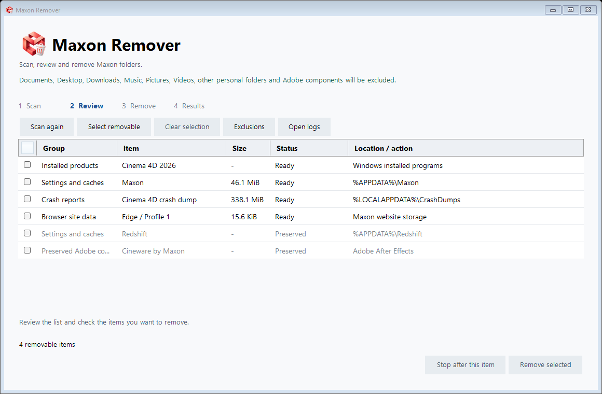
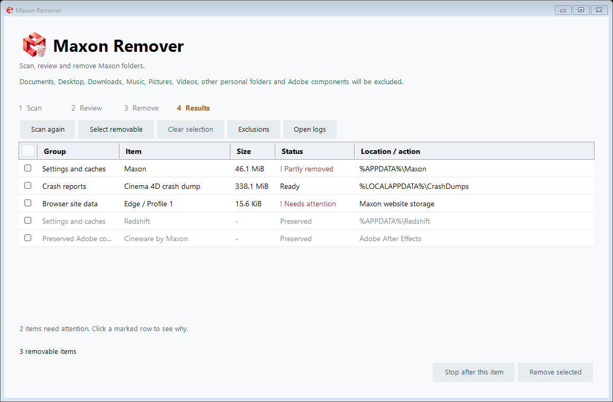

# Maxon Remover

Scan, review and remove Maxon folders on Windows.

**[Download 0.1.5 Alpha](https://github.com/ErDreiwen/maxon-remover/releases/tag/v0.1.5)** · Windows 10/11, 64-bit

Extract the portable ZIP and open **Maxon Remover.exe**. Check the items you want to remove, then choose **Remove selected**.

This alpha build is unsigned. The release includes SHA-256 checksums.

Personal folders and Adobe components are excluded. Selected leftovers are deleted permanently. The app won't restart your PC.

[Downloads and updates](https://github.com/ErDreiwen/maxon-remover/releases) · [Report a problem](https://github.com/ErDreiwen/maxon-remover/issues)

[What's changed](https://webside.kmsi.me/maxon-remover/)

This repository is for downloads, release notes and issues. The app and website source are kept private. The changelog is available in 24 languages.

Windows 10/11, 64-bit. Not made by Maxon.

## Screenshots

Review the scan and choose what to remove.

Anything that needs attention stays in the results with a reason.

These screens use example data.
